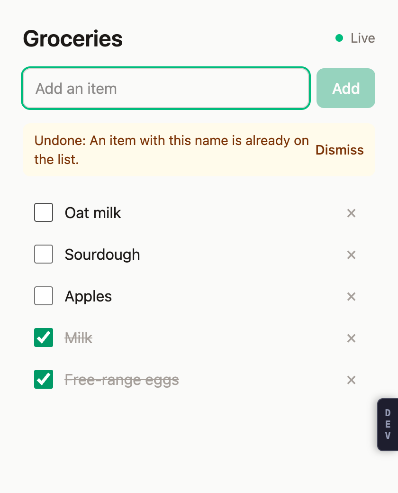
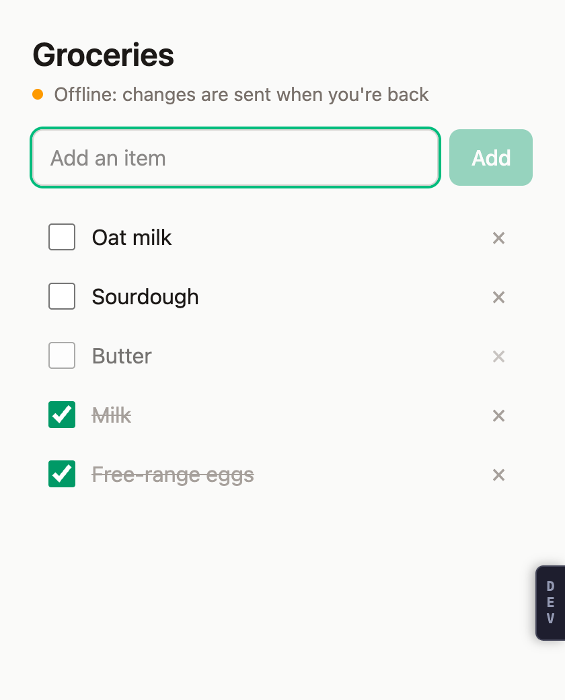

# foldkit-sync-example

A shared grocery list that syncs live between devices and keeps working offline. It's built with [Foldkit](https://foldkit.dev) and [TanStack DB](https://tanstack.com/db) on an [Effect](https://effect.website) server, with no sync engine in between.

 

- An edit on one device shows on every other device as soon as the server has it.
- Edits made offline show at once, marked as saving. They are kept through a reload and sent once the device is back online.
- An edit the server refuses (a name already on the list, for example) is rolled back, and a banner says why.
- After a reload, the list opens from what the device kept, even when the server can't be reached.

## Run it

Node 24.2 or newer.

```sh
npm install
npm run dev:server   # http://localhost:3001, in memory
npm run dev:client   # http://localhost:5180
```

Open http://localhost:5180 in two browser profiles. In devtools, set one of them to offline and edit the list on both.

## How it syncs

```text
device                                            server (Effect HttpApi, in memory)
──────                                            ──────
view ── Message ─► update ── Command ─► SyncedList.send.checkGroceryItem({ groceryItemId })
                                         │ optimistic: the row shows checked, marked saving
                                         │ outbox (IndexedDB): kept until the server answers
                                         └──────── POST /grocery-items/:id/check ──► the CheckGroceryItem use case
                                                                                    answers the item with its seq
SyncedList rows ◄── the items written after lastSeq ── GET /grocery-items/live?afterSeq= (SSE)
   │ the row is synced once the stream reaches the answer's seq: no flicker
   └─ subscribeChanges ─► Message ChangedGroceryItems ─► Model ─► view
```

- **One seq for the whole list.** Every write moves it. The live endpoint sends the items written after a given seq, then again after every later write. It also sends a heartbeat every 10 seconds, so a dead connection is noticed.
- **Writes are intents** (add, rename, check, uncheck, remove), never rows. Each is safe to send twice: a retry of a write the server already ran answers with the current item, so no idempotency key is needed.
- **Refused or retried:** an error the API declares (4xx) rolls the change back with its message. A network error or 5xx is sent again with backoff.
- **Kept on the device:** the rows and `lastSeq` in localStorage, and the unsent writes in IndexedDB.

## The parts

```text
server/src/grocery-item/        the domain, use cases, views and HttpApi
client/src/lib/synced-list.ts   SyncedList: one resource synced, offline-capable; knows nothing of groceries
client/src/grocery-store.ts     SyncedList.make for grocery items, as a Foldkit resource
client/src/main.ts              the Foldkit app: Model, Messages, update, Commands, subscriptions, view
docs/                           the specs: grocery-item.md (server), grocery-list-client.md (client)
```

### Adding an intent

`SyncedList` takes care of the outbox, retries, rollback and the hand-over from the optimistic row to the synced one. A new intent is one entry in `grocery-store.ts`:

```ts
checkGroceryItem: {
  args: Schema.Struct({ groceryItemId: GroceryItemId }),
  optimistic: (rows, { groceryItemId }) =>
    rows.update(groceryItemId, (draft) => {
      draft.status = { _tag: "Checked", checkedAt: nowIso() }
    }),
  send: ({ groceryItemId }) => groceryItems.checkGroceryItem({ params: { groceryItemId } }),
},
```

Then `groceryStore.send.checkGroceryItem({ groceryItemId })` from a Command, and a Message that triggers it.

### Another synced list

`SyncedList.make` holds no grocery-specific code. A server endpoint that answers "the items written after a seq" and writes that answer with their seq are all it needs.

## Tests

```sh
npm run typecheck
npm test        # server: rules, repository, live stream, HTTP edge; client: update
npm run e2e     # two devices in Chrome, against both dev servers on an empty list
```

The e2e drives two separate browser profiles through the following:
- an add, a check-off, a rename and a removal, each seen on the other device;
- a duplicate name, undone with its reason;
- writes made offline;
- a reload while the server can't be reached;
- going back online;
- a removal made while the other device was offline.

## Limits

- The server is in memory, so a restart forgets the list. Clients notice and replace what they kept.
- One shared list, with no sign-in.
- Reloading while the device itself is offline needs a service worker, which this example doesn't have. The kept list covers a reload while only the server is unreachable.
